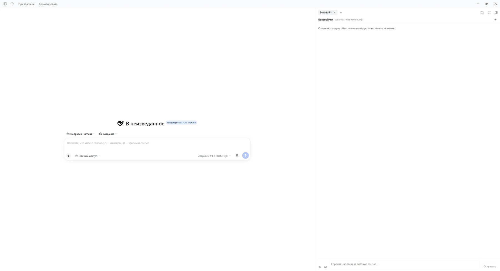

# dsh-side-chat

[English](README.md) | Русский | [中文](README.zh.md)

Вкладка чата в правой панели [DeepSeek Harness](https://github.com/deepseek-ai/deepseek-harness):
**отдельный разговор** рядом с рабочей сессией, который умеет читать и искать,
но **ничего не меняет**.

По сути это обычный чат с ИИ, только внутри DSH: он знает, в каком проекте ты работаешь,
и не трогает файлы.



---

## Зачем

Сессия в DSH — уже чат, зачем второй? Потому что рабочая сессия плохо подходит для «помоги подумать»:
её история заполняется вызовами инструментов, контекст тратится на задачу, а каждый вопрос
съедает ход посреди работы.

Этот плагин даёт второй тред, который:

- живёт в собственной сессии — разговоры не смешиваются;
- наследует рабочую папку, поэтому видит проект, о котором речь;
- ограничен чтением, поэтому «посмотри файл» не превращается в «ой, отредактировал».

## Возможности

| | |
|---|---|
| **Отдельный тред** | Своя сессия, переживает перезагрузку и перезапуск |
| **Вкладка в правой панели** | Открывается рядом с сессией, а не вместо неё |
| **Только чтение** | `read`, `glob`, `grep`, `read_image`, `web_search`, `web_fetch` — без записи, правки и терминала |
| **Стриминг** | Ответ набегает постепенно, есть кнопка «Остановить» |
| **Уровень размышлений** | `off / low / high / max`, выбирается в настройках, применяется к треду |
| **Голосовой ввод** | Запись с микрофона, распознавание через речевой провайдер хоста |
| **Картинки** | Скриншоты отправляются как части промпта |
| **Чистый транскрипт** | Видно, что сказано, а не внутренний монолог модели |

## Требования

- DeepSeek Harness **0.2.x** с веб-интерфейсом (`@deepseek-ai/dsh-web-app`).
- Настроенный провайдер моделей — используется ваш провайдер по умолчанию.
- Для голоса: любой речевой провайдер, зарегистрированный на хосте. Проверено с локальной
  [GigaAM](https://github.com/salute-developers/GigaAM); без провайдера панель просто сообщит,
  что распознавание недоступно.

## Установка

```bash
git clone https://github.com/Uzumaku13/DSH-side-chat-advisor.git
```

Затем из сессии DSH установить каталог как бандл:

```
plugin_manager
  action: install_bundle
  target: /абсолютный/путь/к/dsh-side-chat
```

Из CLI то же самое:

```bash
dsh plugin --profile <профиль> add /абсолютный/путь/к/dsh-side-chat
```

Один бандл ставит **две** строки: сам плагин и пресет агента, на котором он работает
(см. [Зачем в комплекте пресет](#зачем-в-комплекте-пресет)). Второго шага нет.

Дальше: перезапустить DSH либо переключить плагин выключить/включить в
«Настройки → Плагины», затем обновить страницу (`F5`) — клиентская половина это браузерный модуль.

Удалить всё:

```
plugin_manager
  action: remove_bundle
  target: dsh-side-chat
```

## Как пользоваться

**Открыть панель** — кнопка с облачком в заголовке диалога, справа рядом с утилитами сессии.
Вкладка также доступна в списке вкладок правой панели.

В панели:

- **Ввод + Enter** — отправить, Shift+Enter — перенос строки.
- **🎤** — запись, повторное нажатие останавливает. Текст дописывается в поле ввода,
  так что слово можно поправить до отправки.
- **Картинка** — прикрепить изображения, можно несколько.
- **+** в шапке панели — начать новый тред. Старый остаётся на диске, просто больше не показывается.
- **Остановить** заменяет «Отправить», пока модель отвечает.

## Настройки

**Настройки → Плагины → Боковой чат** (и карточка плагина в списке бандлов).

### Уровень размышлений

Сколько модель думает перед ответом: `Off`, `Low`, `High`, `Max`. Список берётся из каталога
моделей, поэтому подстраивается под текущую модель.

По умолчанию `Off`: для чата размышления — основная статья расхода и задержки. Если
планирование начнёт проседать, переключите на `Low` или `High`.

Деталь реализации: `selectModel` в DSH ставит выбор на сессию **и** сохраняет его как
дефолт профиля в фоне. Плагин сразу возвращает прежний дефолт, чтобы рабочие сессии
остались на своём уровне. Проверить можно через `GET /x-side-chat/models.json` —
`default.reasoningEffort` должен оставаться прежним.

### Скрывать кнопку Claude Migration

Необязательно и **по умолчанию выключено**. Плагин `dsh-claude-move` рисует плавающую
кнопку сырым DOM, не через слот, поэтому убрать регистрацию нельзя. Тумблер добавляет одно
CSS-правило; сам плагин и его инструменты продолжают работать. Настройка хранится в
`localStorage` этого браузера.

## Как устроено

### Треды

Панель просит тред у **хоста** (`POST /x-side-chat/thread`). Хост сам создаёт сессию, поэтому
знает её id раньше панели и успевает наложить маску инструментов.

Id треда хранится в браузере (`localStorage: dsh.side-chat.thread.v2`) и дублируется в
`$DSH_HOME/side-chat/threads.json`. Реестр нужен, чтобы маска переприменялась на
`agent/created`: тред, продолженный после перезапуска, сужается до первого хода.

### Только чтение — дважды

Пресет даёт только читающие инструменты. Сверх этого хост применяет `tools.restrict` с явным
списком разрешённых при каждом создании агента. Достаточно было бы любого из двух; вместе они
означают, что будущая правка пресета не выдаст чату терминал по неосторожности.

### История и привязка

У каждого треда есть ровно одно место:

- **свободный** — по умолчанию. Тред, созданный кнопкой «+», не принадлежит никакой сессии,
  виден в истории всех сессий и никогда не подхватывается молча;
- **привязанный** — закреплён за одной сессией булавкой в списке истории, поэтому панель
  открывает его снова, когда возвращаешься в эту сессию.

**«+» ничего не удаляет.** Он создаёт свободный тред и переключается на него. Предыдущий
остаётся в истории, с названием из первого сообщения.

Кнопка с часами в шапке панели открывает историю: «Привязанные к этой сессии» и «Свободные».
Щелчок по строке — переход, булавка привязывает тред к этой сессии или отвязывает, `×` —
убрать из списка. Удаление записи **не** удаляет переписку: это обычная сессия DSH, её журнал
остаётся на диске, пока его не удалить (`$DSH_HOME/sessions/<id>`). Записи, чья сессия уже
удалена, вычищаются автоматически при следующем открытии истории.

Названия берутся из первого сообщения человека и кэшируются в реестре, поэтому открытие
истории стоит одно чтение страницы на безымянный тред и ничего после этого.

### Зачем в комплекте пресет

Пресет агента определяет, что попадает в модель. Тред, созданный на кодинг-пресете, унаследовал бы
рабочий `AGENTS.md`, правила проекта и весь каталог навыков: он отвечал бы отчётами со списками
дел и стоил бы в разы дороже за ход.

Пресет `sidechat` подключает персону, инструменты чтения, веб-доступ и сжатие — и **не**
подключает `agent-instructions`, `tool-skill` и MCP-серверы.

### HTTP-маршруты

| Маршрут | Назначение |
|---|---|
| `POST /x-side-chat/thread` | Создать тред (пресет, маска, модель) |
| `POST /x-side-chat/adviser` | Переприменить маску (идемпотентно, на каждом монтировании) |
| `POST /x-side-chat/model` | Переприменить уровень размышлений к одному треду |
| `POST /x-side-chat/say` | Отправить текст в тред (удобно для проверок) |
| `POST /x-side-chat/voice` | Распознать канонический WAV 16 кГц моно (base64) |
| `GET /x-side-chat/voice.json` | Провайдеры речи, выбор, прогрев |
| `GET /x-side-chat/settings.json` | Текущий уровень, допустимые значения, модель |
| `POST /x-side-chat/settings` | Сохранить уровень и применить ко всем тредам |
| `GET /x-side-chat/models.json` | Каталог моделей |
| `GET /x-side-chat/tools.json` | Инструменты, видимые треду (отладка маски) |
| `GET /x-side-chat/status.json` | Известные треды |
| `GET /x-side-chat/threads.json?owner=` | История: привязанные к сессии плюс свободные |
| `POST /x-side-chat/threads` | `bind` / `unbind` / `forget` для одного треда |
| `GET /x-side-chat/eventpage.json` | Диагностика: что возвращает чтение страницы журнала |

### Что пишется на диск

| Путь | Содержимое |
|---|---|
| `$DSH_HOME/side-chat/threads.json` | Записи тредов: id, владелец, название, дата (и список для маски) |
| `$DSH_HOME/side-chat/settings.json` | Уровень размышлений |
| `localStorage: dsh.side-chat.thread.v3.<сессия>` | Тред, который панель показывает в этой сессии |
| `localStorage: dsh.side-chat.hide-claude-launcher` | Тумблер кнопки миграции |

Сами переписки — обычные журналы сессий DSH, второй копии нет.

## Если что-то не работает

**Вкладка с ошибкой, маршруты отдают 404.** Хост-половина зарегистрировала HTTP-маршруты
раньше, чем появился веб-сервер. Это закрыто ожиданием сервиса (`ctx.inject(['webServer'])`);
если 404 всё же видно после перезапуска — ищите в логе хоста строки `[side-chat]`.

**Тред не создаётся, панель висит на «Создаю отдельный тред…».** Создание намеренно сделано
синглтоном на страницу: правая колонка перемонтирует тело вкладки, и флаг внутри компонента
отменял бы запрос, порождая новую сессию на каждое монтирование. Если зависло — вызовите
`POST /x-side-chat/thread` напрямую, ошибка назовёт причину.

**Голос молчит.** У распознавателя два жёстких требования: *канонический* WAV (44-байтный
заголовок, PCM16) и `language: auto` для провайдеров, объявивших только `auto`. Оба учтены;
при смене провайдера держите их в голове. Фаза провайдера видна в `GET /x-side-chat/voice.json`.

**Ответы как рабочий отчёт.** Тред работает на кодинг-пресете: строка `preset-sidechat`
отсутствует или перекрыта. Проверьте в «Настройки → Плагины».

**Уровень размышлений не применился.** Сессия могла быть продолжена до изменения. Вызовите
`POST /x-side-chat/model` с её id или откройте новый тред.

## Ограничения

- Тред — настоящая сессия DSH: в воркспейсе его не видно, но на диске он есть и сам не удаляется.
  Удалить — `$DSH_HOME/sessions/<id>` (или привычный карантин).
- Текст персоны — русский. Нужен другой язык — правьте пресет в `cordis.patch.yml`;
  сам интерфейс следует локали DSH.
- Шаги инструментов не показываются строками: чат показывает, что сказано, а не что выполнялось.
- Блок runtime-context (`Current working directory…`) по-прежнему уходит в модель из хост-плагина;
  из транскрипта он отфильтрован, но токены расходует.
- Голосу нужно разрешение на микрофон, первый раз может ждать загрузки модели.

## Разработка

Обычный JavaScript, сборки нет.

- Хост: `index.js` (маршруты, создание треда, маска, модель, голос).
- Клиент: `client.js` (регистрации слотов, панель, карточка настроек, захват микрофона).
- Правки `index.js`: переключить плагин выключить/включить (или перезапустить DSH).
- Правки `client.js`: то же **плюс** обновление страницы (`F5`).

Перед публикацией форка задайте `author` в `package.json` и добавьте поле `repository`.

## Участие

Баг-репорты, идеи и патчи приветствуются — см. [CONTRIBUTING.md](CONTRIBUTING.md):
как устроены две половины, как их перезагружать и что должно быть в полезном отчёте.

## Лицензия

MIT — см. [LICENSE](LICENSE).
