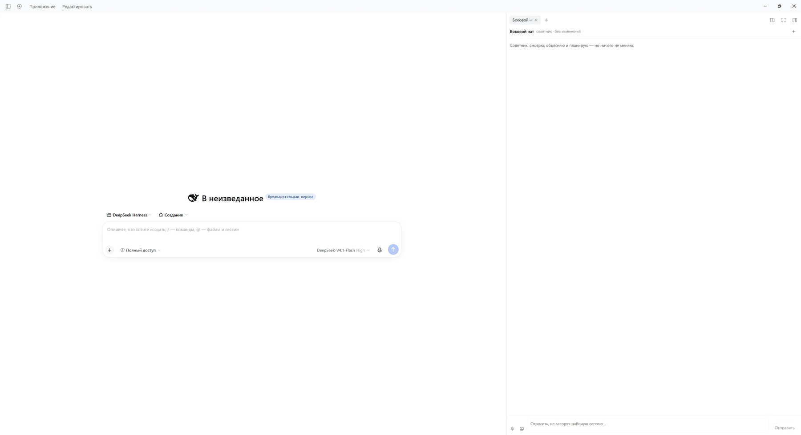

# dsh-side-chat

[English](README.md) | [Русский](README.ru.md) | 中文

[DeepSeek Harness](https://github.com/deepseek-ai/deepseek-harness) 右侧栏里的对话标签页：
一个**独立对话**，就在工作会话旁边，能读取和搜索，但**不会改动任何东西**。

可以把它理解成常开的网页版 AI 对话——只是它长在 DSH 里，已经知道你正在哪个项目里工作，
而且从不碰你的文件。



---

## 为什么需要它

DSH 的会话本身就是对话，为什么还要第二个？因为工作会话并不适合「帮我想想」：
它的记录会被工具调用填满，上下文都花在任务上，每问一句都要占用中间的一轮。

这个插件给你第二个线程，它：

- 运行在自己的会话里，两个对话互不污染；
- 继承当前工作目录，因此真的能看到你提到的项目；
- 只有读取权限，「看一眼这个文件」永远不会变成「哎呀，改坏了」。

## 功能

| | |
|---|---|
| **独立线程** | 自己的 agent 会话，重载和重启后仍然保留 |
| **右栏标签页** | 在会话旁边打开，而不是取代它 |
| **只读** | `read`、`glob`、`grep`、`read_image`、`web_search`、`web_fetch`——不能写入、修改或执行命令 |
| **流式回答** | 回答逐字出现，可随时停止 |
| **推理强度** | `off / low / high / max`，在设置里选择，按线程生效 |
| **语音输入** | 录制麦克风，经宿主的语音提供方转写 |
| **图片** | 附带截图，作为 prompt 内容发送 |
| **干净的记录** | 显示说了什么，而不是模型内部的思考 |

## 环境要求

- DeepSeek Harness **0.2.x**，带 Web 界面（`@deepseek-ai/dsh-web-app`）。
- 已配置的模型提供方（使用你的默认提供方）。
- 语音需要宿主上注册了语音提供方，已用本地
  [GigaAM](https://github.com/salute-developers/GigaAM) 验证；没有提供方时界面会直接说明不可用。

## 安装

```bash
git clone https://github.com/Uzumaku13/DSH-side-chat-advisor.git
```

然后在 DSH 会话里把这个目录作为 bundle 安装：

```
plugin_manager
  action: install_bundle
  target: /绝对路径/dsh-side-chat
```

命令行等价写法：

```bash
dsh plugin --profile <profile> add /绝对路径/dsh-side-chat
```

一个 bundle 会安装**两行**：插件本身，以及它运行所用的 agent preset
（见[为什么预置一起打包](#为什么预置一起打包)）。没有第二步。

然后重启 DSH，或在「设置 → 插件」里把它关掉再打开，再刷新页面（`F5`）——客户端部分是浏览器模块。

卸载：

```
plugin_manager
  action: remove_bundle
  target: dsh-side-chat
```

## 使用

**打开面板**：会话标题栏右侧的对话气泡按钮，就在会话工具按钮旁边。
右栏的标签列表里也能找到它。

面板里：

- **输入后按 Enter** 发送，Shift+Enter 换行。
- **🎤** 录音，再按一次停止；识别结果追加到输入框，发送前可以修改。
- **图片** 附带一张或多张图片。
- **面板顶部的 +** 新建线程。旧线程的记录仍在磁盘上，只是不再显示。
- 模型回答期间，**发送**会变成**停止**。

## 设置

**设置 → 插件 → 侧边对话**（插件列表里该插件的卡片上也有同样内容）。

### 推理强度

模型回答前思考的程度：`Off`、`Low`、`High`、`Max`。列表来自模型目录，因此会跟着当前模型变化。

默认 `Off`：对话中推理 token 是主要开销和主要延迟。如果发现规划变浅，可以切到 `Low` 或 `High`。

实现细节：DSH 的 `selectModel` 会把选择装到会话上，**同时**在后台保存为部署默认值。
插件随后立刻把默认值恢复回去，所以你的编码会话保持自己的强度。可以通过
`GET /x-side-chat/models.json` 检查：`default.reasoningEffort` 应保持原样。

### 隐藏 Claude Migration 按钮

可选，**默认关闭**。`dsh-claude-move` 用原生 DOM 注入浮动按钮，不走 slot，因此无法注销。
开关只添加一条 CSS 规则隐藏它；插件本身及其工具照常工作。设置保存在本浏览器的 `localStorage`。

## 工作原理

### 线程

面板向**宿主**请求线程（`POST /x-side-chat/thread`）。由宿主自己创建会话，所以它比面板更早
知道会话 id，能在同一时刻套上工具掩码。

线程 id 保存在浏览器（`localStorage: dsh.side-chat.thread.v2`），并镜像到
`$DSH_HOME/side-chat/threads.json`。这个登记表用于在 `agent/created` 时重新套用掩码——
重启后继续的线程会在第一轮之前被收窄。

### 双重只读

preset 只提供读取工具；此外宿主在每次创建 agent 时用显式白名单调用 `tools.restrict`。
任意一层单独都够用；两层同时存在意味着以后改 preset 不会意外给对话一个终端。

### 历史与绑定

每个线程只属于一个位置：

- **已绑定**——从某个会话创建，之后在该会话里打开面板时会回到它；
- **自由**——没有归属，在任何会话的历史里都能看到。

**「+」不会删除任何东西。** 它会新建一个绑定到当前会话的线程并切换过去，之前的那个留在
历史列表里，标题取自它的第一条消息。

面板标题栏的时钟按钮打开历史：*绑定到本会话* 与 *自由对话*。点击条目切换，链接图标用于
绑定或解绑，`×` 从列表中移除。移除条目**不会**删除对话——那是普通的 DSH 会话，日志会一直
留在磁盘上，直到你手动删除（`$DSH_HOME/sessions/<id>`）。会话已被删除的条目会在下次打开
历史时自动清理。

标题取自每个线程的第一条人类消息并缓存到登记表，因此打开历史时每个无标题线程只多一次
日志读取，之后为零。

### 为什么预置一起打包

agent preset 决定哪些内容进入模型。如果用编码 preset 创建线程，它会继承工作区的
`AGENTS.md`、项目规则和整个技能目录：回答会变成报告和任务清单，每轮成本也高得多。

随包提供的 `sidechat` preset 只挂载 persona、读取工具、网页访问和压缩——
**不挂** `agent-instructions`、`tool-skill` 和任何 MCP 服务器。

### HTTP 接口

| 路由 | 用途 |
|---|---|
| `POST /x-side-chat/thread` | 创建线程（preset、掩码、模型） |
| `POST /x-side-chat/adviser` | 重新套用掩码（幂等，每次挂载都会调用） |
| `POST /x-side-chat/model` | 对单个线程重新套用推理强度 |
| `POST /x-side-chat/say` | 向线程发送文本（方便测试） |
| `POST /x-side-chat/voice` | 转写标准 16 kHz 单声道 WAV（base64） |
| `GET /x-side-chat/voice.json` | 语音提供方、当前选择、预热 |
| `GET /x-side-chat/settings.json` | 当前强度、可选值、模型 |
| `POST /x-side-chat/settings` | 保存强度并应用到所有已知线程 |
| `GET /x-side-chat/models.json` | 模型目录 |
| `GET /x-side-chat/tools.json` | 线程可见的工具名（调试掩码） |
| `GET /x-side-chat/status.json` | 已知线程 |
| `GET /x-side-chat/threads.json?owner=` | 历史：绑定到某会话的线程加自由线程 |
| `POST /x-side-chat/threads` | 对单个线程执行 `bind` / `unbind` / `forget` |
| `GET /x-side-chat/eventpage.json` | 诊断：某线程的日志页返回什么 |

### 写入磁盘的内容

| 路径 | 内容 |
|---|---|
| `$DSH_HOME/side-chat/threads.json` | 线程记录：id、归属、标题、时间（也是掩码用的清单） |
| `$DSH_HOME/side-chat/settings.json` | 推理强度 |
| `localStorage: dsh.side-chat.thread.v3.<会话>` | 该会话下面板显示的线程 |
| `localStorage: dsh.side-chat.hide-claude-launcher` | 隐藏按钮的开关 |

对话本身是普通的 DSH 会话日志，没有第二份副本。

## 遇到问题时

**标签页报错，或插件的路由返回 404。** 宿主半身在 Web 服务就绪之前注册了路由。
现在通过 `ctx.inject(['webServer'])` 等待服务；若重启后仍然 404，请在宿主日志里查找
`[side-chat]` 开头的行。

**线程创建不出来，面板一直停在「正在创建独立对话…」。** 创建过程刻意做成了页面级单例：
右栏会重新挂载标签页内容，组件内的标志会让请求被丢弃，并每次挂载都新建一个会话。
如果卡住，直接调用 `POST /x-side-chat/thread`，返回的错误会指出原因。

**语音没有反应。** 转写器有两个硬性要求：*标准* WAV（44 字节头、PCM16），以及只声明了
`auto` 的提供方必须传 `language: auto`。两者都已处理；更换提供方时请留意。
`GET /x-side-chat/voice.json` 可以看到提供方的状态。

**回答像工作报告。** 线程跑在编码 preset 上：`preset-sidechat` 行缺失或被覆盖。
在「设置 → 插件」里确认该行处于启用状态。

**推理强度没生效。** 会话可能在修改之前就被恢复了。用它的 id 调 `POST /x-side-chat/model`，
或新建一个线程。

## 限制

- 线程是真正的 DSH 会话：它不出现在工作区里，但确实存在于磁盘上，也不会自动回收。
  删除 `$DSH_HOME/sessions/<id>` 即可。
- persona 文本是俄语，但已指示按提问语言回答（俄语、英语、中文）。想改措辞就编辑
  `cordis.patch.yml` 里的 preset；界面本身跟随 DSH 的语言设置。
- 工具调用不会显示为条目：对话显示说了什么，而不是执行了什么。
- `Current working directory…` 这类运行时上下文仍由宿主插件发给模型；记录里被过滤掉，
  但会消耗 token。
- 语音需要麦克风权限，第一次可能需要等模型加载。

## 参与

欢迎 bug 报告、想法和补丁——见 [CONTRIBUTING.md](CONTRIBUTING.md)（英文），
里面说明了两半的结构、如何重载，以及一份有用的报告应该包含什么。

## 许可证

MIT——见 [LICENSE](LICENSE)。
